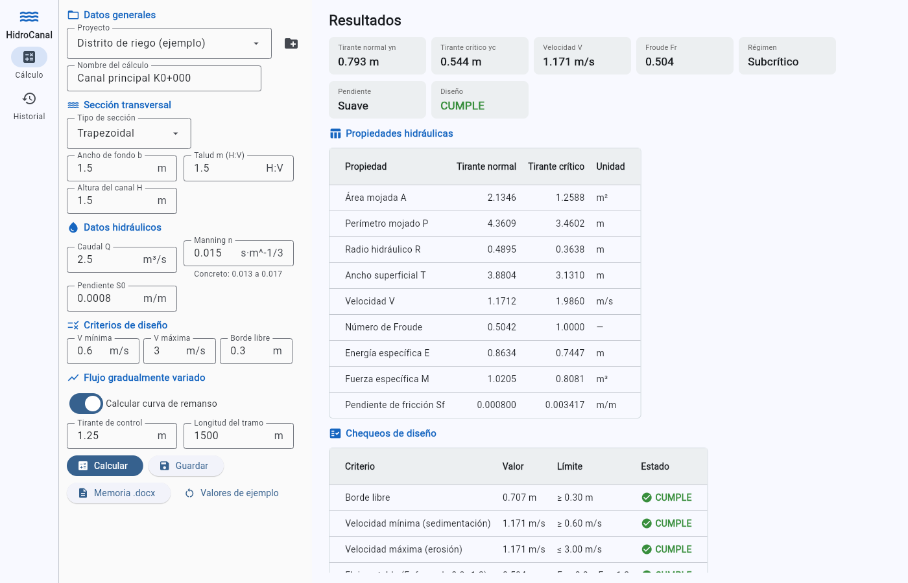
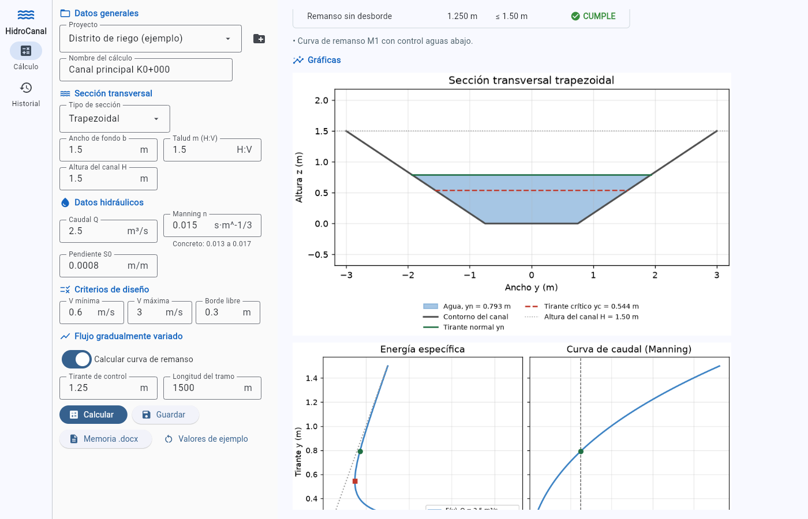
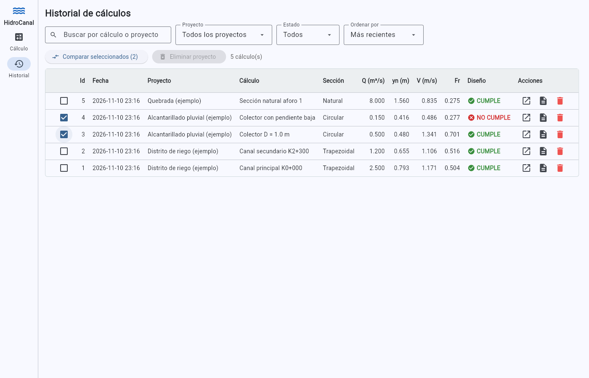
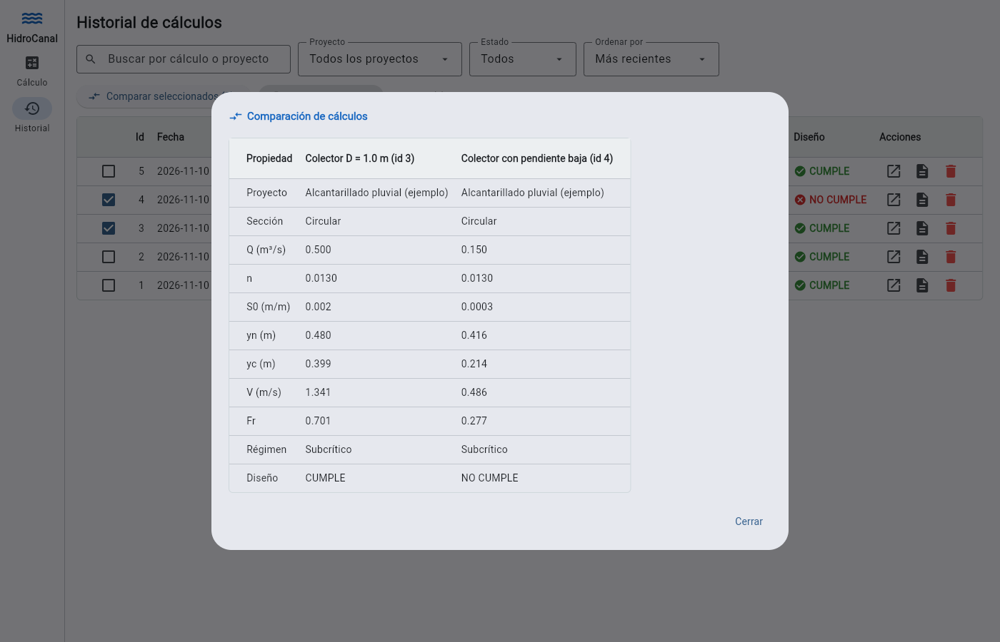
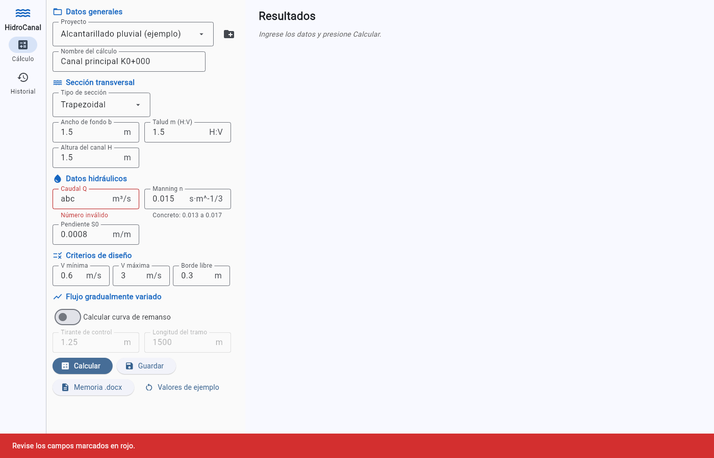
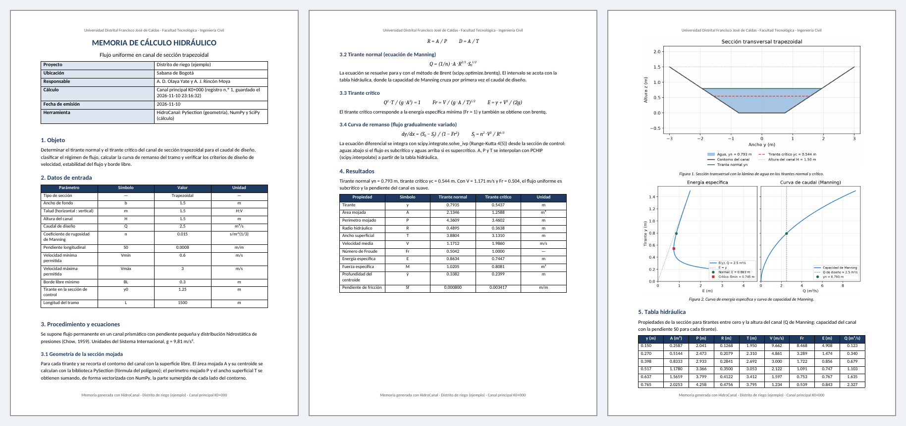

# HidroCanal: flujo uniforme en canales abiertos

Aplicación de escritorio para el análisis hidráulico de canales: calcula el **tirante normal** (Manning), el **tirante crítico**, el régimen de flujo y la **curva de remanso**, verifica criterios de diseño (cumple / no cumple), guarda los proyectos en una base de datos y genera automáticamente la **memoria de cálculo en Word**.

**Programación II · Proyecto 02 · Semestre 2026-III · Grupo 18**
Universidad Distrital Francisco José de Caldas, Facultad Tecnológica, Ingeniería Civil.

| Autoras | Proyecto 01 que se integra |
|---|---|
| Alixon Dayana Olaya Yate | [canal_pysection](https://github.com/alixonolaya16/canal_pysection) |
| Allison Juliana Rincón Moya | [Centroides_Ingenieria_Civil](https://github.com/allisonjulianarinconmoya-alt/Centroides_Ingenieria_Civil) |



---

## Contenido

1. [Problema de ingeniería](#1-problema-de-ingeniería)
2. [Fundamento teórico](#2-fundamento-teórico)
3. [Métodos numéricos](#3-métodos-numéricos)
4. [Validación](#4-validación)
5. [Capturas de pantalla](#5-capturas-de-pantalla)
6. [Instalación](#6-instalación)
7. [Uso paso a paso](#7-uso-paso-a-paso)
8. [Estructura del proyecto](#8-estructura-del-proyecto)
9. [Base de datos](#9-base-de-datos)
10. [Memoria de cálculo](#10-memoria-de-cálculo)
11. [Integración de PySection y de los proyectos 01](#11-integración-de-pysection-y-de-los-proyectos-01)
12. [Pruebas](#12-pruebas)
13. [Limitaciones](#13-limitaciones)
14. [Referencias](#14-referencias)
15. [Licencia](#15-licencia)

---

## 1. Problema de ingeniería

El diseño de un canal de riego, un colector de aguas lluvias o la revisión de la capacidad de un cauce natural requieren conocer, para el caudal de diseño:

- la **profundidad de flujo uniforme** (tirante normal), que define la altura del canal y el borde libre;
- el **tirante crítico**, que separa el flujo subcrítico del supercrítico y permite clasificar la pendiente;
- la **velocidad media**, que debe ser suficiente para evitar la sedimentación pero no tan alta que erosione el revestimiento;
- el **perfil de la superficie del agua** (curva de remanso) cuando una estructura de control (compuerta, vertedero, cambio de pendiente) modifica el tirante.

La ecuación de Manning no tiene solución explícita para el tirante en secciones trapezoidales, circulares o naturales: a mano se resuelve por tanteo y la curva de remanso exige integrar una ecuación diferencial por pasos. HidroCanal automatiza ese procedimiento para cinco tipos de sección: **rectangular, trapezoidal, triangular, circular** (colector parcialmente lleno) y **natural** (coordenadas de un levantamiento topográfico).

> El programa resuelve el problema hidráulico de flujo permanente en un canal prismático. No diseña estructuras ni reemplaza el criterio del ingeniero: los límites de velocidad y borde libre los define el usuario según el revestimiento y la norma aplicable al proyecto.

## 2. Fundamento teórico

Hipótesis (Chow, 1959): flujo permanente, canal prismático de pendiente pequeña, distribución hidrostática de presiones y coeficiente de Manning constante en la sección. Unidades SI, g = 9.81 m/s².

**Geometría de la sección mojada.** Para un tirante *y*, A es el área mojada, P el perímetro mojado, T el ancho superficial, R = A/P el radio hidráulico y ȳ la profundidad del centroide del área mojada bajo la superficie.

| Concepto | Ecuación |
|---|---|
| Ecuación de Manning (tirante normal yn) | Q = (1/n) · A · R^(2/3) · S0^(1/2) |
| Condición de flujo crítico (tirante crítico yc) | Q² · T / (g · A³) = 1 |
| Número de Froude | Fr = V / √(g · A / T) |
| Energía específica | E = y + V² / (2g) |
| Fuerza específica | M = Q² / (g · A) + A · ȳ |
| Flujo gradualmente variado | dy/dx = (S0 − Sf) / (1 − Fr²), con Sf = n² · V² / R^(4/3) |

**Clasificación.** El flujo es subcrítico si Fr < 1 y supercrítico si Fr > 1. La pendiente es suave si yn > yc y empinada si yn < yc. Los perfiles de remanso se nombran M1, M2, M3, S1, S2 o S3 según la pendiente y la zona en la que se encuentra el tirante de control (Chow, 1959, cap. 9).

**Chequeos de diseño** (los límites los ingresa el usuario):

| Chequeo | Condición |
|---|---|
| Borde libre | H − yn ≥ BL mínimo |
| Velocidad mínima (sedimentación) | V ≥ Vmín |
| Velocidad máxima (erosión del revestimiento) | V ≤ Vmáx |
| Flujo estable | Fr < 0.8 o Fr > 1.2 (el flujo cercano al crítico tiene superficie ondulada e inestable) |
| Remanso sin desborde (si se calcula) | tirante máximo del perfil < H |

## 3. Métodos numéricos

| Paso | Herramienta | Por qué |
|---|---|---|
| Área mojada y centroide | **PySection** (`_SinglePolygonSection`) | La sección mojada es un polígono: PySection calcula su área y centroide con la fórmula del polígono. Funciona igual para cualquier forma, incluida una sección natural. |
| Perímetro mojado y ancho superficial | **NumPy** vectorizado | Se construye una matriz *tirantes × lados del contorno* con la fracción sumergida de cada lado (`np.clip`). P y T salen de una suma por filas, sin ciclos. |
| Tabla hidráulica | **NumPy** | R, V, Fr, E y la capacidad de Manning se calculan como arreglos sobre 200 tirantes. |
| Tirante normal y crítico | **`scipy.optimize.brentq`** | Ambas ecuaciones son de una variable y cambian de signo una sola vez en el intervalo que se toma de la tabla hidráulica. Brent combina bisección (convergencia garantizada) con interpolación (rapidez) y no necesita derivadas. Tolerancia de 1·10⁻¹⁰ m. |
| Interpolación de A, P y T | **`scipy.interpolate.PchipInterpolator`** | Interpolante monótono: no genera oscilaciones (A y P crecen con *y*) y es mucho más rápido que recalcular la geometría en cada paso de integración. |
| Curva de remanso | **`scipy.integrate.solve_ivp`** (RK45) | La ecuación del flujo gradualmente variado es una EDO de primer orden. Se integra desde la sección de control (aguas abajo si el flujo es subcrítico, aguas arriba si es supercrítico) con paso adaptativo y eventos que detienen la integración si el perfil llega al tirante crítico o desborda el canal. |

PySection analiza un polígono a la vez, por eso la columna de áreas de la tabla hidráulica se obtiene con un ciclo sobre los tirantes (`modelo.tabla_hidraulica`). Todo lo demás está vectorizado.

## 4. Validación

Las pruebas automáticas (`tests/test_modelo.py`) comparan el modelo con estos casos.

**Caso 1: resuelto a mano (método de tanteo).** Canal trapezoidal con b = 1.5 m, m = 1.5, n = 0.015, S0 = 0.0008 y Q = 2.5 m³/s.

Fórmulas: A = (b + m·y)·y, P = b + 2·y·√(1 + m²), Q = A · R^(2/3) · √S0 / n.

| y (m) | A (m²) | P (m) | R (m) | R^(2/3) | Q (m³/s) |
|---|---|---|---|---|---|
| 0.700 | 1.7850 | 4.0239 | 0.4436 | 0.5816 | 1.958 |
| 0.800 | 2.1600 | 4.3844 | 0.4927 | 0.6238 | 2.541 |
| 0.790 | 2.1212 | 4.3484 | 0.4878 | 0.6197 | 2.479 |
| **0.7935** | **2.1347** | **4.3610** | **0.4895** | **0.6211** | **2.500** |

| Resultado | A mano | HidroCanal |
|---|---|---|
| Tirante normal yn | 0.7935 m | 0.7935 m |
| Tirante crítico yc (Q²T/gA³ = 1) | 0.5437 m | 0.5437 m |

**Caso 2: literatura.** Chow (1959), capítulo 6: canal trapezoidal con b = 20 ft, talud 2:1, S0 = 0.0016, n = 0.025 y Q = 400 ft³/s. El libro obtiene **yn = 3.36 ft**; HidroCanal obtiene **3.361 ft** (1.0245 m).

**Casos 3 a 5: fórmulas cerradas.**

| Caso | Fórmula | Diferencia |
|---|---|---|
| yc en canal rectangular | yc = (q²/g)^(1/3) | < 10⁻⁸ |
| yc en canal triangular | yc = (2Q²/(g·m²))^(1/5) | < 10⁻⁷ |
| Tubo a media sección | A = πD²/8, centroide a 4r/(3π) | < 10⁻⁴ (círculo de 360 lados) |

Además se verifica que el área calculada por PySection coincida con la integral ∫T dy calculada con NumPy/SciPy, que la fuerza específica sea mínima en el tirante crítico y que la curva M1 tienda al tirante normal aguas arriba.

## 5. Capturas de pantalla

**Vista Cálculo: gráficas de la sección y de la energía específica**


**Vista Historial: búsqueda, filtros y acciones por cálculo**


**Comparación de cálculos guardados**


**Validación de entradas: la aplicación no se cierra con datos inválidos**


**Memoria de cálculo generada** ([ejemplos/memoria_ejemplo.docx](ejemplos/memoria_ejemplo.docx))


## 6. Instalación

**Requisitos:** Python 3.12, 3.13 o 3.14 ([python.org](https://www.python.org/downloads/); en Windows marque *Add Python to PATH*) y Git ([git-scm.com](https://git-scm.com/downloads)). La primera vez que se abre la aplicación, Flet descarga su componente de escritorio, así que se necesita conexión a internet.

```bash
git clone https://github.com/alixonolaya16/hidrocanal.git
cd hidrocanal
python -m venv .venv
```

Active el entorno virtual:

- Windows (PowerShell o CMD): `.venv\Scripts\activate`
- macOS / Linux: `source .venv/bin/activate`

Instale las dependencias (versiones fijadas en `requirements.txt`) y abra la aplicación:

```bash
pip install -r requirements.txt
python main.py
```

También funciona `flet run main.py`. La base de datos `datos/hidrocanal.db` se crea sola la primera vez.

## 7. Uso paso a paso

1. **Crear un proyecto.** En la vista **Cálculo**, pulse el ícono de carpeta junto a *Proyecto* y escriba nombre, ubicación y responsable.
2. **Ingresar los datos.** Elija el tipo de sección y llene la geometría, el caudal Q (m³/s), el coeficiente n de Manning y la pendiente S0 (m/m). Cada campo muestra su unidad.
   - En una sección **natural**, escriba una pareja `y z` por línea (en metros), de la orilla izquierda a la derecha.
   - Los **criterios de diseño** (velocidad mínima y máxima, borde libre) vienen con valores típicos que se pueden cambiar.
3. **Curva de remanso (opcional).** Active el interruptor e ingrese el tirante en la sección de control y la longitud del tramo.
4. **Calcular.** Aparecen el resumen (yn, yc, V, Fr, régimen, pendiente y estado CUMPLE / NO CUMPLE), la tabla de propiedades, los chequeos y las gráficas. Si un dato está vacío o no es un número, el campo se marca en rojo y un mensaje explica el problema.
5. **Guardar.** Guarda el cálculo en el proyecto seleccionado.
6. **Memoria .docx.** Genera la memoria de cálculo en la carpeta `reportes/` y ofrece abrirla.
7. **Historial.**
   - Busque por nombre del cálculo o del proyecto, y filtre por proyecto o por estado.
   - Ordene por fecha, caudal, velocidad o nombre.
   - En cada fila puede **reabrir** el cálculo, generar su **memoria** o **eliminarlo**; el borrado pide confirmación.
   - Marque dos o más casillas y pulse **Comparar seleccionados** para ver los cálculos lado a lado.
   - Con un proyecto seleccionado en el filtro se puede **eliminar el proyecto** completo, también con confirmación.

El modelo se puede usar sin abrir la ventana:

```python
from app.modelo import DatosEntrada, analizar

resultado = analizar(DatosEntrada(tipo="Trapezoidal", b=1.5, m=1.5, H=1.5, Q=2.5, n=0.015, S0=0.0008))
print(round(resultado.normal["y"], 4), round(resultado.critico["y"], 4), resultado.cumple)   # 0.7935 0.5437 True
```

## 8. Estructura del proyecto

```text
hidrocanal/
├── main.py                 # punto de entrada: abre la aplicación Flet
├── requirements.txt        # dependencias con versión fijada
├── LICENSE                 # GPL-3.0 (la misma de PySection)
├── app/
│   ├── geometria.py        # secciones, recorte a la lámina de agua, P y T vectorizados (PySection + NumPy)
│   ├── modelo.py           # tabla hidráulica, yn, yc, remanso y chequeos (NumPy + SciPy); sin Flet
│   ├── db.py               # conexión y consultas SQLite (todo el SQL está aquí)
│   ├── graficas.py         # figuras de Matplotlib: sección, energía específica, remanso
│   ├── reporte.py          # memoria de cálculo con docxtpl
│   ├── pysections/
│   │   └── sections.py     # PySection, copia sin modificaciones
│   └── ui/
│       ├── aplicacion.py   # ventana y navegación entre vistas
│       ├── vista_calculo.py
│       ├── vista_historial.py
│       └── comunes.py      # campos numéricos, tablas, diálogos y avisos
├── plantillas/
│   └── memoria.docx        # plantilla Jinja propia para docxtpl
├── tests/                  # pruebas con pytest
└── ejemplos/
    ├── memoria_ejemplo.docx
    └── capturas/
```

Cada capa tiene una sola responsabilidad. `modelo.py` y `geometria.py` no importan Flet ni SQLite; `db.py` no sabe de la interfaz; las vistas solo leen datos, llaman al modelo y muestran resultados.

## 9. Base de datos

SQLite con dos tablas relacionadas por llave foránea. El borrado en cascada hace que, al eliminar un proyecto, se eliminen también sus cálculos.

```text
proyectos (id PK, nombre UNIQUE, ubicacion, responsable, creado)
    1 ──── N
calculos  (id PK, proyecto_id FK → proyectos.id ON DELETE CASCADE, fecha, nombre, tipo_seccion,
           entradas JSON, Q, n, S0, yn, yc, V, Fr, regimen, cumple)
```

- Las **entradas** completas se guardan como JSON para reabrir y recalcular el cálculo.
- Los **resultados principales** van en columnas propias para listar, buscar, ordenar y comparar.
- Todas las consultas usan parámetros `?`.
- El criterio de orden se elige de un diccionario cerrado (`db.ORDENES`), nunca a partir de texto escrito por el usuario.

## 10. Memoria de cálculo

La plantilla `plantillas/memoria.docx` (se puede editar en Word) contiene:

- encabezado con los datos del proyecto;
- objeto del cálculo;
- tabla de datos de entrada;
- procedimiento con las ecuaciones;
- tabla de resultados para los tirantes normal y crítico;
- tabla hidráulica;
- curva de remanso;
- tabla de chequeos;
- conclusión **CUMPLE / NO CUMPLE**;
- referencias.

Las tablas se generan con `` y las gráficas de Matplotlib (las mismas que muestra la aplicación) se insertan con `InlineImage`. La memoria se genera desde la vista Cálculo o desde cualquier fila del Historial. El ejemplo [ejemplos/memoria_ejemplo.docx](ejemplos/memoria_ejemplo.docx) corresponde al canal trapezoidal del caso de validación 1, con su curva de remanso.

## 11. Integración de PySection y de los proyectos 01

- **PySection** ([rvcristiand/pySections](https://github.com/rvcristiand/pySections)):
  - `app/pysections/sections.py` es una **copia sin ninguna modificación** del archivo del profesor, igual a la que se descarga en el taller de Flet con `curl`.
  - Se incluye dentro del repositorio, en lugar de usar un submódulo de Git, para que el proyecto funcione con un `git clone` normal seguido de `pip install -r requirements.txt`.
  - `geometria.PoligonoMojado` hereda de `_SinglePolygonSection` e implementa `_calculate_points()`, que es la forma prevista por la biblioteca de definir secciones nuevas (como `Deck` o `BulbTeeGirderBridge`).
  - Al importarse, `sections.py` activa el estilo `ggplot` de Matplotlib; por eso `graficas.py` dibuja dentro de `matplotlib.style.context("default")`.
- **canal_pysection** (Proyecto 01, A. D. Olaya): aportó el caso de aplicación (la sección hidráulica de un canal) y la técnica de subclase de PySection. En el Proyecto 01 el polígono de agua se escribía a mano para un solo tirante; aquí se genera automáticamente para cualquier tirante.
- **Centroides_Ingenieria_Civil** (Proyecto 01, A. J. Rincón): aportó la idea de construir figuras paramétricas (rectángulo, triángulo, círculo aproximado por polígono) y figuras libres por coordenadas, con su validación. Aquí se convirtieron en las secciones rectangular, triangular, circular y natural.

## 12. Pruebas

```bash
python -m pytest
```

Hay 22 pruebas:

- `tests/test_modelo.py`:
  - los casos de validación de la sección 4;
  - la fuerza específica;
  - la verificación cruzada PySection ↔ ∫T dy;
  - la curva de remanso y la clasificación de perfiles;
  - los chequeos;
  - el rechazo de datos inválidos.
- `tests/test_db_reporte.py`:
  - la creación automática de la base de datos;
  - guardar, buscar, filtrar, ordenar y reabrir;
  - que una consulta con inyección SQL no devuelva nada;
  - el borrado en cascada;
  - que la memoria tenga tablas, tres gráficas, conclusión y ninguna etiqueta Jinja sin reemplazar.

## 13. Limitaciones

- Canal prismático con rugosidad uniforme: no se calcula la rugosidad compuesta ni las secciones con planicies de inundación de distinta n.
- El círculo se aproxima con un polígono regular de 360 lados (error de área < 0.01 %).
- En secciones naturales, el tirante máximo es la cota de la orilla más baja; la geometría debe ir de izquierda a derecha.
- La curva de remanso se detiene si llega al tirante crítico: el resalto hidráulico no se modela.
- En tubos circulares, la ecuación de Manning tiene dos soluciones cerca de la clave; el programa toma la menor, que es la de flujo a superficie libre.

## 14. Referencias

- Chow, V. T. (1959). *Open-Channel Hydraulics*. McGraw-Hill.
- French, R. H. (1985). *Open-Channel Hydraulics*. McGraw-Hill.
- Ramírez Vargas, C. D. (2025). *PySection: A Python library for cross-sectional properties calculation*. https://github.com/rvcristiand/pySections
- Virtanen, P. et al. (2020). SciPy 1.0: fundamental algorithms for scientific computing in Python. *Nature Methods*, 17, 261–272.
- Documentación: [Flet](https://flet.dev/docs/), [docxtpl](https://docxtpl.readthedocs.io/), [sqlite3](https://docs.python.org/3/library/sqlite3.html), [SciPy](https://docs.scipy.org/doc/scipy/).

## 15. Licencia

GNU GPL v3.0 (ver [LICENSE](LICENSE)). La aplicación incluye y extiende PySection, que se distribuye con esta licencia.
